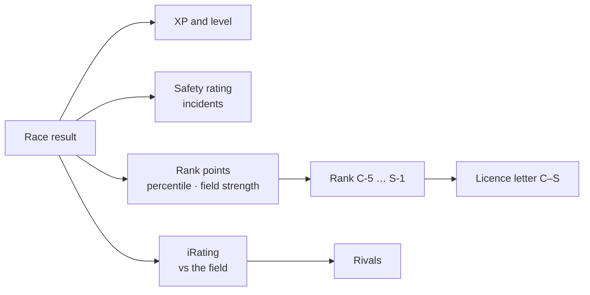

# Progression and rank

Every finished race feeds [spz-progression](../modules/spz-progression.md).

| System | Meaning |
|---|---|
| **Rank (RP)** | `C-5` … `S-1`, derived from Rank Points. Display and prestige only |
| **XP / level** | Reward for playing |
| **Safety Rating (SR)** | Clean driving — incidents and contact push it down (daily caps) |
| **iRating** | Relative pace against the field, zero-sum Elo; used for rivals |



## Rank (ranking v3)

Rank is one number, **Rank Points**, looked up in a 20-rung table (C 0 / B 250 / A 1,150 /
S 3,850 RP to enter; steps of 50 / 180 / 540 / 1,000 between sub-ranks). After each
**rated** race (2+ players) each player gets one RP delta from their finishing percentile,
the field size, and the field's strength relative to them, plus small supports (clean race,
streak, perfect lap, track record). RP never drops below the floor of your current class, and
positive RP is capped at +300 per day. There is no limit on field size.

`license_tier` (`0 = C` … `3 = S`) is just the stored class letter, derived from RP and
written through `spz-identity:UnlockLicense`. **Nothing gates cars, tracks or classes on it.**

## Formulas

All numbers below are the shipped defaults in `spz-progression/config.lua`
(`Config.Rules`, `Config.IRating`, `Config.SR`, `Config.XPRewards`). The pure maths lives
in `spz-progression/domain/` and is covered by `tests/run.lua`.

### Rank Points (RP)

One integer delta per player per **rated** race (2+ players, 45 s+).

```text
N         = field size, position = finishing place (1 = winner)
s         = (N - position) / (N - 1)            winner 1.0, last 0.0, DNF 0.0
w         = min(1, (N - 1) / 5)                 small fields count for less
podium    = {10, 6, 3}[position] * ramp         ramp = 0 at N <= 8, full at N >= 24
base      = (60 * (s - 0.35) + 2) * w + podium
f         = clamp(1 + (fieldAvgRP - yourRP) / 2000, 0.5, 1.5)
if base > 0:  delta = base * f * min(1.5, 1 + clean + streak)
else:         delta = base * (2 - f)
delta     = round(delta + perfectLap + trackRecord)
```

| Term | Value | Meaning |
|---|---|---|
| `slope` | 60 | RP between last place and the winner, before weighting |
| `breakEven` | 0.35 | Finishing percentile where the base is about zero |
| `participation` | +2 | Flat RP for taking part |
| `clean` | +0.15 | Boost for a race with zero incidents |
| `streak` | +0.05 per race, max +0.20 | Consecutive finishes in the top max(3, 10% of N) |
| `perfectLap` / `trackRecord` | +10 each | Flat RP, added after the boost |
| `f` | 0.5 – 1.5 | Field strength: beating stronger drivers pays more, losing to weaker ones costs more |

After the delta: RP never drops below the **floor of your current class**, and positive RP
is capped at **+300 per UTC day**.

**Worked example** — 8 drivers, everyone on 1,000 RP (so `f = 1`), `w = 1`, no podium bonus at N = 8:

| Finish | s | base | Result |
|---|---|---|---|
| P1, clean | 1.000 | 60 × 0.65 + 2 = 41.0 | 41.0 × 1.15 = **+47** |
| P4 | 0.571 | 60 × 0.221 + 2 = 15.3 | **+15** |
| P6 | 0.286 | 60 × −0.064 + 2 = −1.9 | **−2** |
| P8 / DNF | 0.000 | 60 × −0.35 + 2 = −19.0 | **−19** |

### Rank ladder

Four classes of five sub-ranks (5 = entry, 1 = top). Sub-rank `k` steps above entry needs
`enter + step × k` RP.

| Class | Enter at | Step | Sub-ranks |
|---|---|---|---|
| C | 0 | 50 | C-5 … C-1 |
| B | 250 | 180 | B-5 … B-1 |
| A | 1,150 | 540 | A-5 … A-1 |
| S | 3,850 | 1,000 | S-5 … S-1 (top 100 numbered on the board) |

### iRating

Zero-sum pairwise Elo, used for display and rival matching (not rank).

```text
E(i, j) = 1 / (1 + 10 ^ ((R_j - R_i) / 400))
S(i, j) = 1 if i finished ahead of j, 0 if behind, 0.5 if both DNF
Δ_i     = Σ_j  32 * (S(i, j) - E(i, j)) / (N - 1)        start 1500, range 0 – 5000
```

### Safety Rating (SR)

```text
DNF:       -0.20
otherwise: +0.05 finish, +0.10 top 3 (or +0.05 top 5), +0.03 personal best,
           -0.02 per incident (at most -0.10 per race)
```

Range 0.00 – 5.00, start 2.00, capped at +0.50 / −0.40 per UTC day.

### XP and level

```text
XP     = (position XP + laps + bonuses) * class multiplier * pace * anti-abuse
         position XP: 250, 175, 125, 100, 85, 75, 65, 55 (DNF 25)
         laps: +10 each (max +50) · clean +25 · PB +50 · track record +100
         class multiplier: C 1.00 · B 1.25 · A 1.50 · S 1.75
XP needed for level L = floor(50 * (L - 1)^2 + 50 * (L - 1))      level 1 – 100
```

## Vehicle classes

Race classes only — Coupes, Muscle, Sports Classics, Sports, Super, Open Wheel. Civilian,
service, utility and prop vehicles are not spawnable.

## Rivals

Each player is paired with the nearest player by iRating. Beating your rival's stored time
on a track pings both of you in game and on Discord. `/rival` shows yours.

## Bonuses

**Perfect lap** — purple in all three sectors of the same lap, in a race or a time trial,
grants flat XP and credits (`Config.PerfectLap`) with a notification, rank-up sting and
post-fx flourish. It rewards the flawless lap, not merely the fast one.

Other one-off rewards use the generic export:

```lua
exports['spz-progression']:GrantBonus(source, { xp = 250, credits = 500, reason = 'event' })
```

## Record crowns

Holding a track's fastest stored line earns a gold crown on your nametag, rendered by
`spz-nametag` from the `spz:records` statebag (with a count when you hold more than one).
Taking a record broadcasts to everyone — "X snatched the [track] record from Y" — and logs
to Discord. Crown counts refresh live for both the new holder and the dethroned one.

In-world record boards at configurable spots show a track's fastest-lap holders as floating
scoreboards you walk up to and read — no menu.
