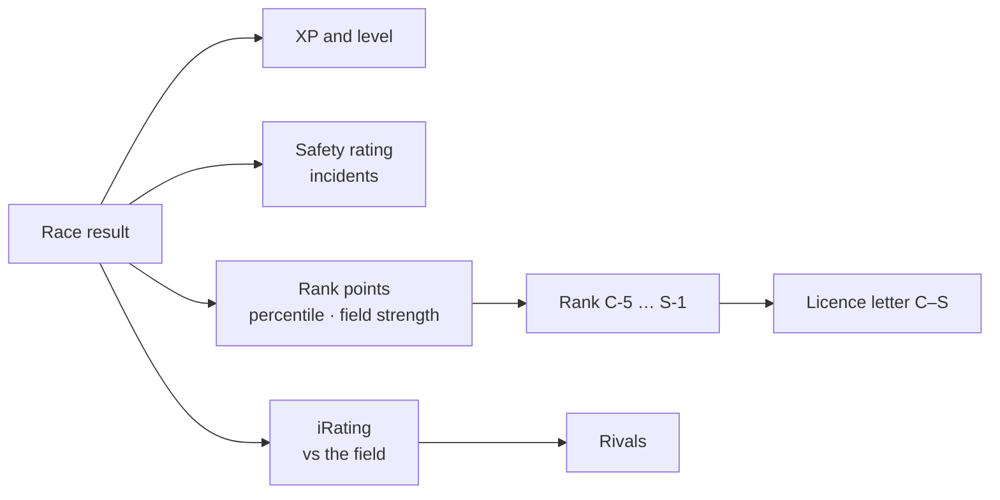

# Progression and rank

Every finished race feeds [spz-progression](../modules/spz-progression.md).

| System | Meaning |
|---|---|
| **Rank (RP)** | `C-5` … `S-1`, derived from Rank Points. Display and prestige only |
| **XP / level** | Reward for playing |
| **Safety Rating (SR)** | Clean driving — incidents and contact push it down (daily caps) |
| **iRating** | Relative pace against the field, zero-sum Elo; used for rivals |



## Rank (ranking v3)

Rank is one number, **Rank Points**, looked up in a 20-rung table (C 0 / B 250 / A 1,150 /
S 3,850 RP to enter; steps of 50 / 180 / 540 / 1,000 between sub-ranks). After each
**rated** race (2+ players) each player gets one RP delta from their finishing percentile,
the field size, and the field's strength relative to them, plus small supports (clean race,
streak, perfect lap, track record). RP never drops below the floor of your current class, and
positive RP is capped at +300 per day. There is no limit on field size.

`license_tier` (`0 = C` … `3 = S`) is just the stored class letter, derived from RP and
written through `spz-identity:UnlockLicense`. **Nothing gates cars, tracks or classes on it.**

## Vehicle classes

Race classes only — Coupes, Muscle, Sports Classics, Sports, Super, Open Wheel. Civilian,
service, utility and prop vehicles are not spawnable.

## Rivals

Each player is paired with the nearest player by iRating. Beating your rival's stored time
on a track pings both of you in game and on Discord. `/rival` shows yours.

## Bonuses

**Perfect lap** — purple in all three sectors of the same lap, in a race or a time trial,
grants flat XP and credits (`Config.PerfectLap`) with a notification, rank-up sting and
post-fx flourish. It rewards the flawless lap, not merely the fast one.

Other one-off rewards use the generic export:

```lua
exports['spz-progression']:GrantBonus(source, { xp = 250, credits = 500, reason = 'event' })
```

## Record crowns

Holding a track's fastest stored line earns a gold crown on your nametag, rendered by
`spz-nametag` from the `spz:records` statebag (with a count when you hold more than one).
Taking a record broadcasts to everyone — "X snatched the [track] record from Y" — and logs
to Discord. Crown counts refresh live for both the new holder and the dethroned one.

In-world record boards at configurable spots show a track's fastest-lap holders as floating
scoreboards you walk up to and read — no menu.
