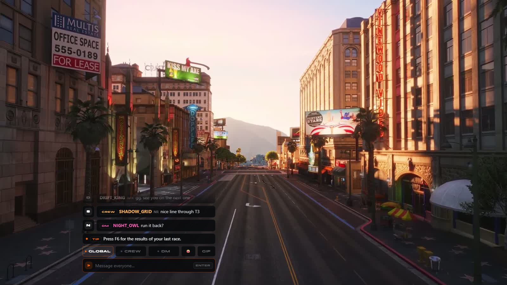
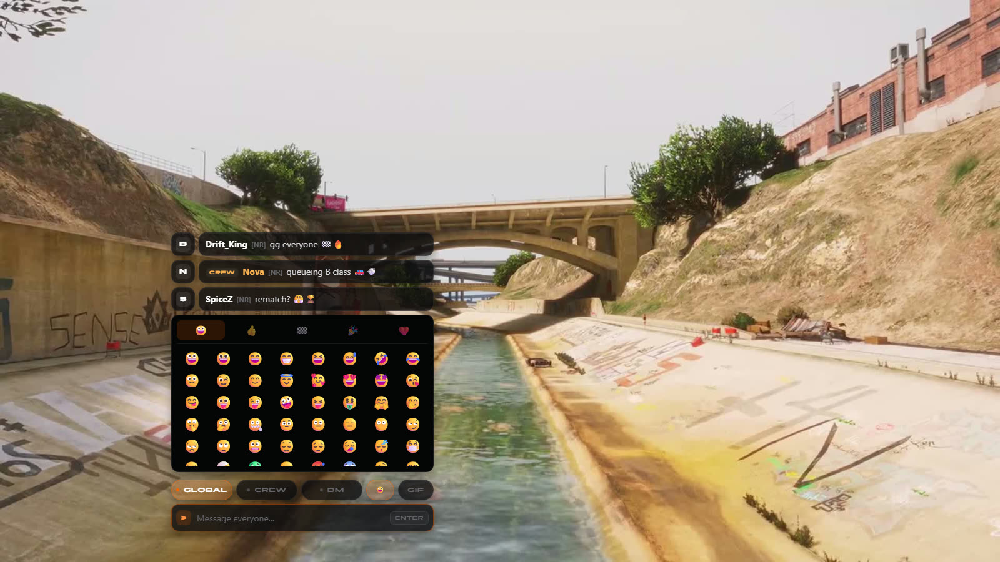
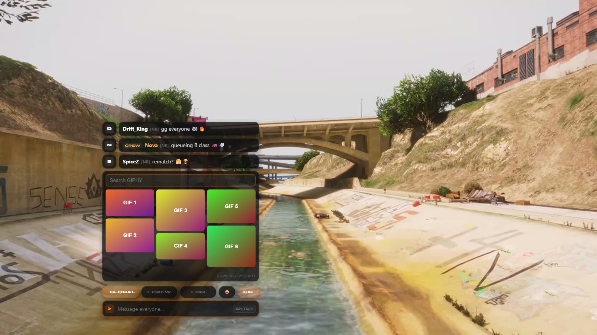

# Chat

> Global, crew and DM chat with command autocomplete.

> Part of [spz-hud](spz-hud.md): this was the separate resource `spz-chat` until it was merged in. Nothing to install on its own.

## Overview

Replaces the default chat. `T` opens it; messages go to global, crew or direct channels, and slash commands autocomplete. Closes itself whenever the player is teleported or a race / minigame takes over.







## Features

- Global, crew and DM channels
- Command autocomplete
- Hidden during the loading screen and spawn menu
- Auto-closes on teleports and mode changes

## Configuration

- `spz-hud/config_chat.lua (`Config.Chat`), and `config_chat_server.lua` for the GIPHY API keys (server only)`

See the file for every option.

## Commands

| Command | Who | Description |
|---|---|---|
| `/help` | player | List every server feature and its key |

## Key binds

Rebindable in **Settings → Key Bindings → FiveM**.

| Action | Default |
|---|---|
| Open chat | `t` |

## Exports

| Export | Side |
|---|---|
| `CloseChat` | client |
| `IsChatOpen` | client |

```lua
exports["spz-hud"]:CloseChat()
```

---

Source: [https://github.com/SPiceZ21/spz-hud](https://github.com/SPiceZ21/spz-hud)
