# spz-hud

> The one interface layer: hosts every SPiceZ UI on one page, with player-placed HUD, shared focus and one look.

 

## Overview

Every screen in SPiceZ-Core is drawn by spz-hud: the race HUD, speedometer, menus, chat, nametags, minigame HUD and the rest. Each UI used to be its own NUI page with its own fonts, colours and focus handling; now they are layers of one page, so they share one look, never fight over the mouse, and never overlap.

The other resources keep their Lua and their NUI callbacks. A small shim they load redirects their `SendNUIMessage` / `SetNuiFocus` to spz-hud, so their code did not change.

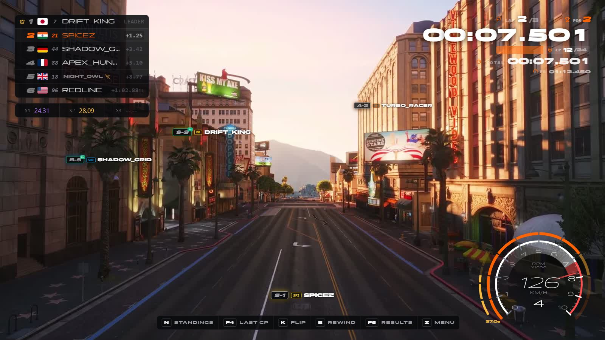

## Features

- **One page, every UI.** 19 resources' interfaces are hosted as layers; only the loading screen stays separate (FiveM requires it).
- **Player layout.** `/hudedit`: drag any HUD element, scroll to resize it, hide it; saved per player.
- **HUD settings.** Analogue or digital speedometer, in the same editor.
- **Key strip.** The keys for what you are doing right now, with your own bindings.
- **The hub (TAB).** One full-screen place for your profile, standings, rivals, replays, speed records, crew and achievements.
- **Game states.** Freeroam, race, minigame and spectate: each shows only its own HUD.
- **Shared focus.** One owner for mouse and keyboard; closing a menu hands focus back to what is underneath.
- **One look.** A shared design layer (fonts, panels, colours, radii) over every UI.
- **Checkpoint DUI pages.** The in-world checkpoint pill and gate animation.

## Game states

spz-hud works out the state from the player's statebags and shows each element only where it belongs.

| State | When | What shows |
|---|---|---|
| Freeroam | default | profile card, speedometer, nametags, key strip |
| Race | `inRace` / `inTimeTrial` | race HUD (standings, sectors, lap · timer, radar), speedometer, key strip |
| Minigame | `inMinigame` / `inPursuit` | the minigame's own HUD, speedometer |
| Spectate | `spectating` | spectate bar and live race board |

The whole HUD hides behind the pause menu and screen fades.

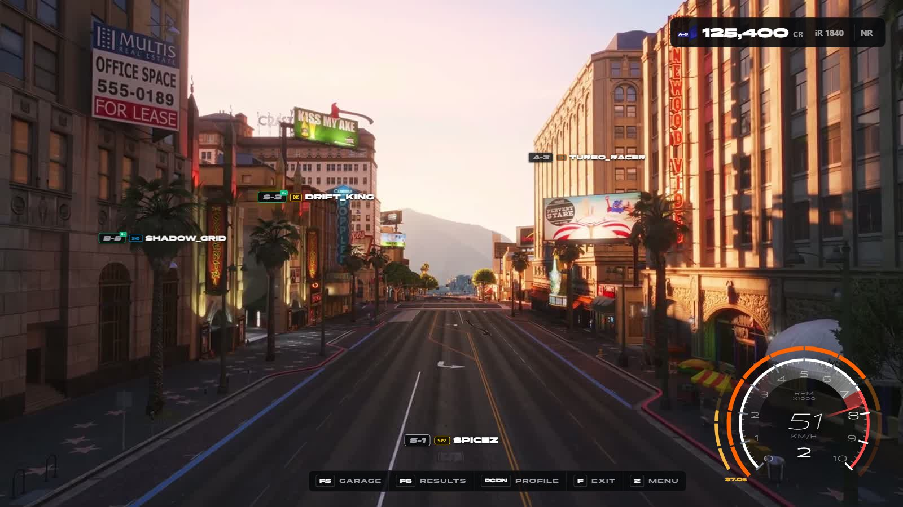

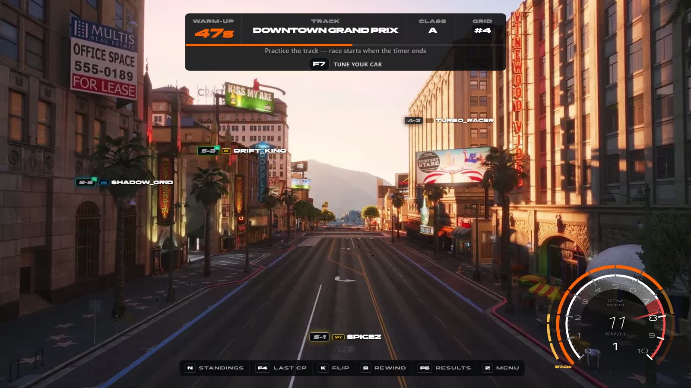

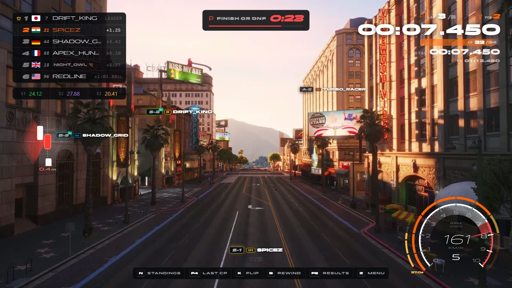

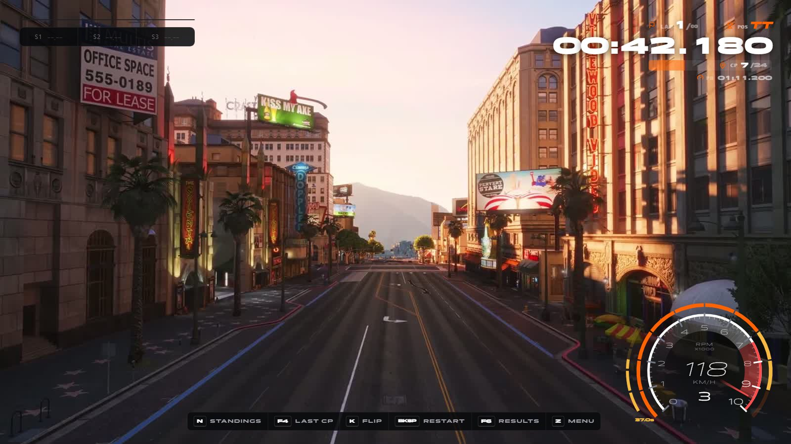

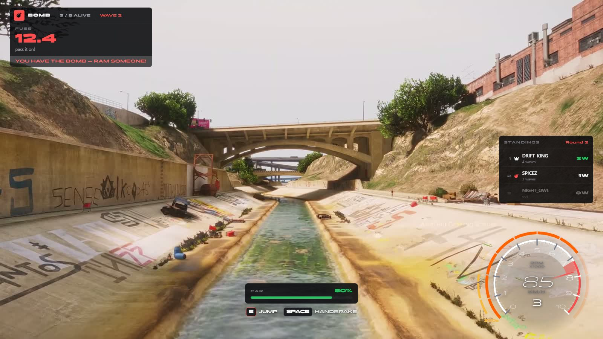

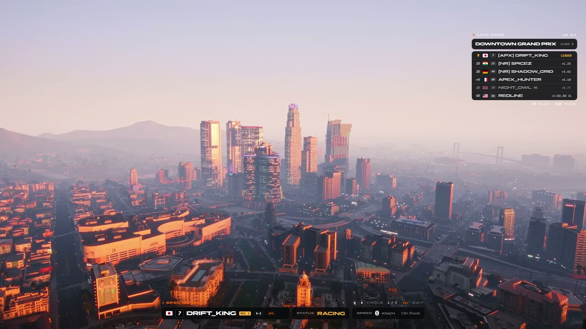

## Layout editor

`/hudedit` opens the editor over the live HUD. Every element has a handle:

- **Drag** to move it, **scroll** to resize it (50–200%).
- **Hide** turns it off; **Reset** puts it back where it started.
- **Save** stores the layout for this player (client KVP); **Cancel** or `Esc` throws the changes away; **Reset** returns everything to the default.

Elements that are not on screen right now (the race HUD while you are in freeroam) appear with sample data so they can still be placed.

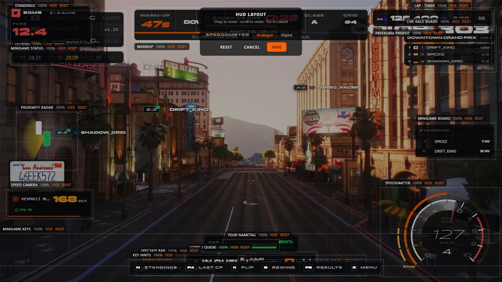

Movable: speedometer; race standings, sectors, lap · timer, proximity radar, warmup, finish countdown, lobby, wanted level, profile card, fastest lap, flourish; your nametag; minigame status, keys and board; spectate bar and race board; speed camera; Rocket League score; chat; radio. Elements that follow the world (checkpoint marker, other players' nametags) and full-screen moments (countdown, intro, results) are not movable.

## HUD settings

In the editor toolbar, saved with the layout.

| Setting | Values |
|---|---|
| Speedometer | **Analogue** (dial, rev glow trailing the needle) or **Digital** (gear ring, slim italic speed, rev bar, rewind/boost bar) |

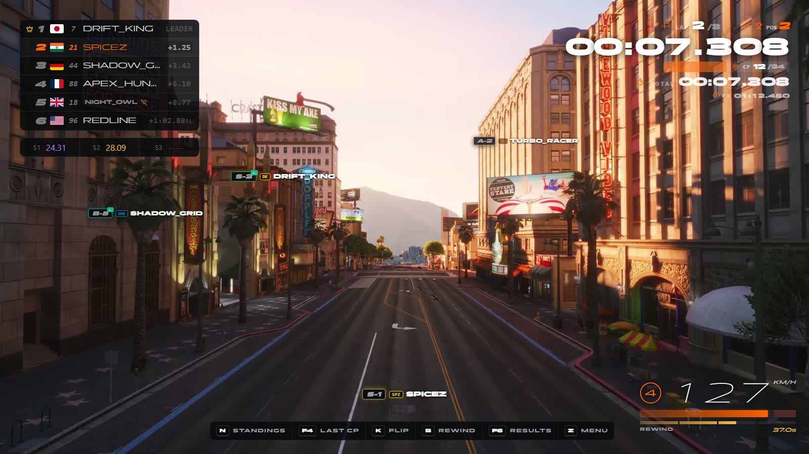

Both read the same data from spz-speedometer, and each is placed on its own. The small bar under the digital speed is boost while boost is on, otherwise the race's rewind budget, in four pieces of 15 s.

## Key strip

Bottom centre-right: what you can press right now.

| State | Keys |
|---|---|
| Freeroam, on foot | Garage · Emotes · Results · Profile · Hub · Menu |
| Freeroam, in a car | Garage · Results · Profile · Exit · Hub · Menu |
| Race | Standings · Last CP · Flip · Rewind · Results · Hub · Menu |
| Time trial | Standings · Last CP · Flip · Restart · Results · Hub · Menu |
| Minigame / spectate | — (they draw their own) |

Keys are read live through spz-core's `KeyFor`, so a rebind in *Settings → Key Bindings → FiveM* shows within about a second, and picking up a controller switches every key to its pad button. Keys with no controller binding are hidden on a pad.

## The hub (TAB)

Press **TAB** for the hub; **TAB** or **ESC** closes it, **Q** / **E** change section.

| Section | What it is |
|---|---|
| Profile | your stats, rank, activity and history charts |
| Standings | global standings · class standings · track records |
| Rivals | rival board · duels · server activity |
| Replays | the race archive, with replays |
| Speed records | your speed-camera bests |
| Crew | the crew dashboard: roster, rival crew, settings, invites |
| Achievements | milestones from your career: races, wins, podiums, iRating, safety, licence class, level, tracks |

The sections are the existing screens (the leaderboard tablet from spz-races, spz-crew, spz-speedcam), opened through their own commands so they load their data as always, and laid into the hub's frame. Achievements are worked out in the hub from the career stats the profile section already shows; there is no separate achievements table.

TAB is GTA's weapon wheel by default; on a racing server that wheel has nothing to do, so the hub takes the key. Players can rebind it (*Settings → Key Bindings → FiveM → Open the SPiceZ hub*).

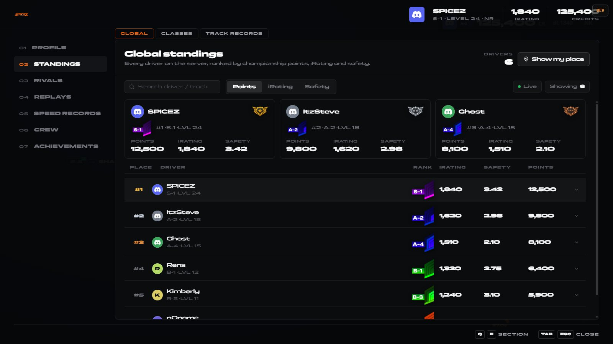

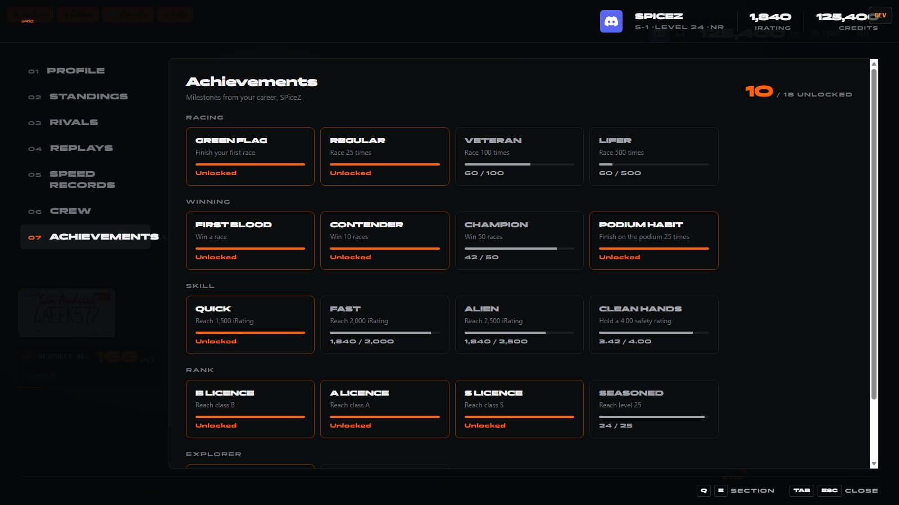

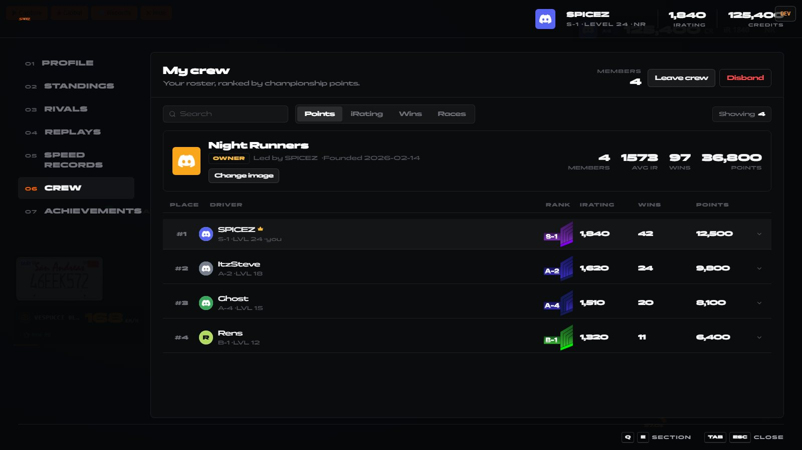

## Configuration

`config.lua`

| Option | Default | |
|---|---|---|
| `Config.EditCommand` | `hudedit` | the layout editor command |
| `Config.LayoutVersion` | `1` | bump to drop players' saved layouts |
| `Config.Snap` | `0.5` | drag snap, % of the screen |
| `Config.Widgets` | speedometer (digital), key strip | spz-hud's own widgets: default spot, anchor, scale, states |

## Exports

| Export | Side | Purpose |
|---|---|---|
| `Register(id, def)` | client | add a widget at runtime |
| `Push(id, data)` | client | send data to one widget |
| `SetVisible(id, bool)` | client | force a widget off / back on |
| `GetState()` | client | `freeroam` · `race` · `minigame` · `spectate` |
| `IsEditing()` | client | true while `/hudedit` is open |
| `IsHubOpen()` | client | true while the hub is open |
| `RequestFocus(owner, opts)` | client | take the mouse / keyboard |
| `ReleaseFocus(owner)` | client | give it back |
| `FocusOwner()` | client | who has focus |

Event: `spz-hud:state` (client), with the new state.

## For resource authors

A resource whose UI spz-hud hosts loads the shim first and depends on spz-hud:

```lua
client_scripts {
    '@spz-hud/shim.lua',   -- NUI goes through spz-hud
    'client/main.lua',
}
dependencies { 'spz-hud' }
```

Its page lives in `spz-hud/web/public/apps/<resource>/`.

A resource that drives several pages (one that absorbed others: spz-races drives `spz-raceUI`, `spz-poll` and `spz-leaderboard`) loads `@spz-hud/app.lua` instead of the shim, and binds each file to its page:

```lua
local SendNUIMessage, SetNuiFocus, SetNuiFocusKeepInput = SpzHudApp('spz-poll')
```

The app's `owner` in `tools/sync-apps.mjs` makes its page post its NUI callbacks to that resource. The look comes from `spz-hud/design/` (shared tokens, plus per-app rules); edit there rather than in the app.

## Developing

```
cd spz-hud/web
npm install
npm run dev      # browser preview at http://localhost:5173
npm run build    # writes ../ui
```

The preview runs every hosted UI with a control panel: game states with sample data (freeroam, warmup, race, last lap, results, time trial, minigame, spectate…), one-off events (fastest lap, overtake, rank up…), every app openable with sample data, and a log of NUI callbacks.

## Installation

```cfg
ensure spz-hud
```

Start it **before** every resource it hosts and before spz-races (which loads its checkpoint DUI pages from it).
