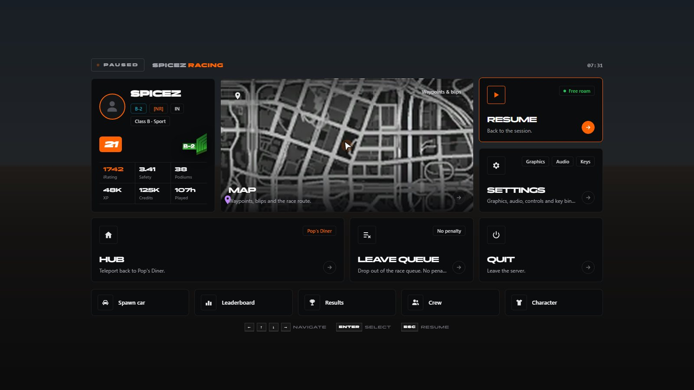

# Pause menu

> Replaces the GTA pause menu.

> Part of [spz-hud](spz-hud.md): this was the separate resource `spz-pausemenu` until it was merged in. Nothing to install on its own.

## Overview

`Esc` opens a SPiceZ pause menu: map, teleport to hub, leave the current queue / race / minigame, settings and quick tiles for the main screens.



## Features

- Map and settings shortcuts
- Leave race / queue / minigame
- Quick tiles for spawner, leaderboard, crew, appearance

## Configuration

- `spz-hud/config_pausemenu.lua (`Config.PauseMenu`)`

See the file for every option.

## Exports

| Export | Side |
|---|---|
| `ClosePauseMenu` | client |
| `IsPauseMenuOpen` | client |
| `OpenPauseMenu` | client |

```lua
exports["spz-hud"]:OpenPauseMenu()
```

---

Source: [https://github.com/SPiceZ21/spz-hud](https://github.com/SPiceZ21/spz-hud)
