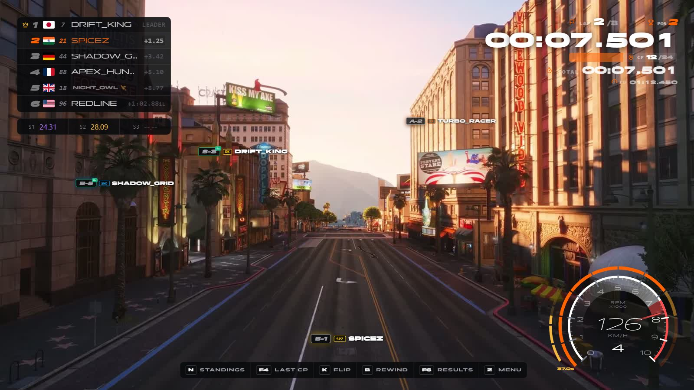
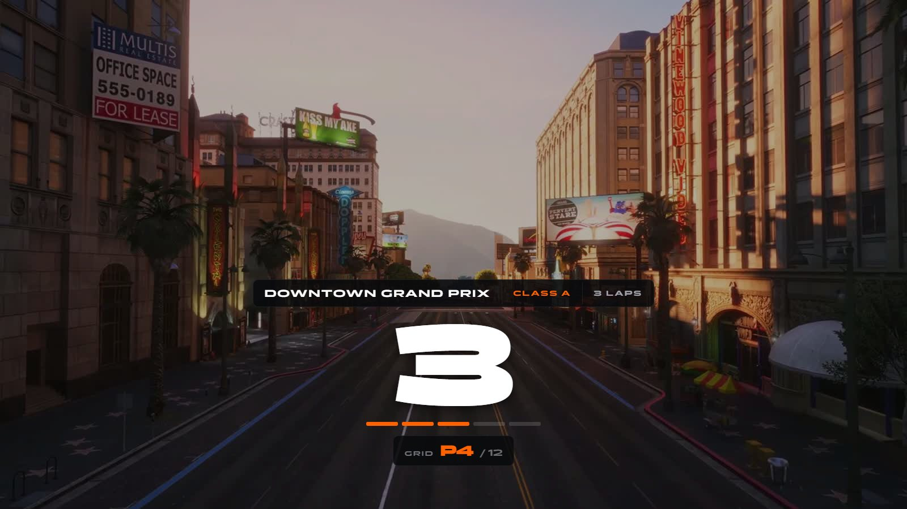
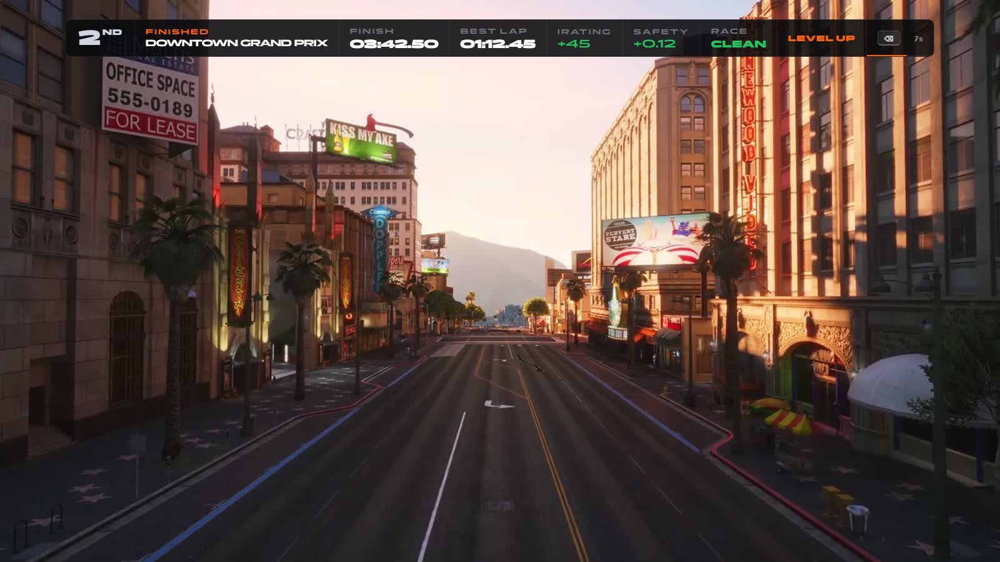
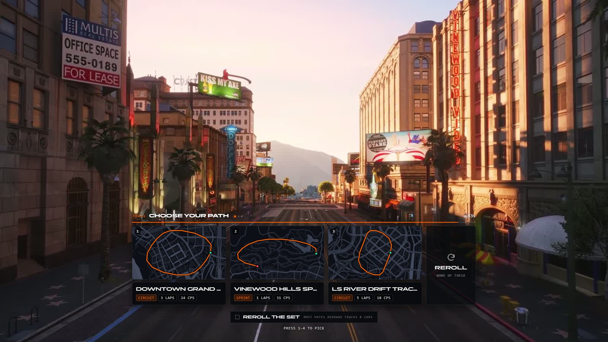
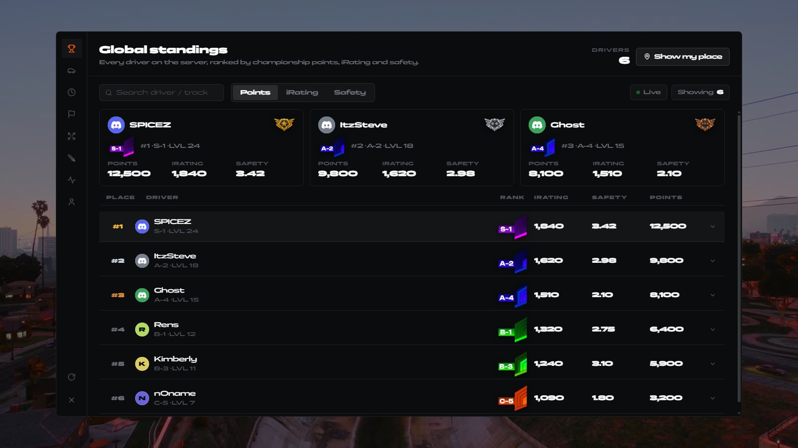

# spz-races

> The race engine: queue, vote, grid, warmup, checkpoints, timing, results, race HUD and leaderboard.

 

## Overview

Runs the whole race loop on the server. Players queue, vote on track and car class, spawn on a grid in a private bucket, free-drive a warmup, then race. Lap, sector and finish times are measured server-side. Also includes Time Trials, duels and **Track Studio** for building tracks in the world.

It also drives the race HUD, the vote screen and the leaderboard tablet (they were spz-raceUI, spz-poll and spz-leaderboard before they were merged in). [spz-hud](spz-hud.md) draws them.

## Features

- Queue → vote → warmup → countdown → race → results cycle
- Late join during warmup
- Server-side lap / sector / finish timing
- Road-following GPS route and 3D distance pills over the next gates
- Rewind (4 × 15 s budget per race), flip and back-to-checkpoint recovery
- Time Trials and 1v1 duels
- Track Studio: drive the route and drop gates (`custom_tracks.json`)
- Flag girl race start
- Race HUD: intro cover, countdown, lap / sector / position HUD, standings, finish window, post-race stats, lobby pill
- Vote screen: track cards with route outlines, car class, re-roll, live tallies
- Leaderboard tablet (`F6`): last race, archive, standings, classes, records, activity, rank-ups

## Requirements

| Resource | Type |
|---|---|
| `ox_lib` | third-party |
| `spz-core` | SPiceZ module |
| `spz-identity` | SPiceZ module |
| `spz-vehicles` | SPiceZ module |
| `spz-hud` | SPiceZ module (draws its pages) |
| `oxmysql` | third-party |

## Installation

Included in the [txAdmin recipe](https://github.com/SPiceZ21/spz-txrecipe). Manual install:

1. Download `spz-races` from GitHub (latest release, or the repository) into your `resources` folder.
2. Add to `server.cfg`, after its requirements:

```cfg
ensure spz-races
```

## Race HUD, vote and leaderboard

| Screen | Lua | Page in spz-hud |
|---|---|---|
| Race HUD | `client/ui/raceui.lua`, `client/ui/raceui_boot.lua` | `apps/spz-raceUI` |
| Vote | `client/ui/poll.lua` | `apps/spz-poll` |
| Leaderboard tablet | `client/ui/leaderboard.lua` | `apps/spz-leaderboard` |

Each file binds itself to its page through `@spz-hud/app.lua`, and each page's NUI callbacks post to spz-races (apps.json `owner`).











## Configuration

- `config.lua`
- `server/leaderboard/config.lua`

See the file for every option.

## Commands

| Command | Who | Description |
|---|---|---|
| `/leaderboard` | player | Open the leaderboard |
| `/raceresults` | player | Open the latest race results |
| `/duel` | player | `/duel <player> <track> <stake>` — challenge a player |
| `/joinrace` | player | Join the race queue (also `E` in freeroam) |
| `/leaverace` | player | Leave the queue / race |
| `/quittt` | player | Quit the time trial |
| `/srace` | player | Start a quick solo race |
| `/timetrail` | player | Start a time trial |
| `/clearstart` | admin | Remove a surveyed start line |
| `/racehud` | admin | Re-read race HUD convars |
| `/setstart` | admin | Survey a start line for a track |
| `/startlines` | admin | List surveyed start lines |
| `/checkgateprops` | dev | Check gate prop models resolve |
| `/copdebug` | dev | Cop-chase debug overlay |
| `/cpdebug` | dev | Draw checkpoint gates in 3D |
| `/fixheadings` | dev | Recompute gate headings |
| `/flagdrop` | dev | Preview the flag girl animation |
| `/racesoundtest` | dev | Play the grid sounds |
| `/wantedtest` | dev | Preview the wanted HUD |
| `/rankuptest` | dev | Preview the rank-up animation |

## Key binds

Rebindable in **Settings → Key Bindings → FiveM**.

| Action | Default |
|---|---|
| Race: tune car during warmup | `Y` |
| Race: back to last checkpoint | `F4` |
| Race: flip car upright | `K` |
| Race: Rewind Time | `B` |
| Time Trial — Restart to Start | `BACK` |
| Race results / leaderboard | `F6` |
| Race: toggle standings list | `N` |
| HUD: show / hide freeroam info | `PAGEDOWN` |

## Exports

| Export | Side |
|---|---|
| `ConfirmRaceSpawn` | server |
| `GetCheckpointDebug` | client |
| `GetCurrentCP` | client |
| `GetQueueCount` | server |
| `GetRaceInfo` | server |
| `GetRespawnPoint` | client |
| `GetRewindCreditMs` | client |
| `GetTTCpIndex` | client |
| `HandlePlayerDisconnect` | server |
| `HideAll` | client |
| `HideFinishWindow` | client |
| `HideRaceIntro` | client |
| `HideRewind` | client |
| `HideWarmup` | client |
| `IsInTimeTrial` | server |
| `IsQueued` | server |
| `IsRewinding` | client |
| `IsTrackCreatorActive` | client |
| `IsTrackEditorActive` | client |
| `IsTrackStudioActive` | client |
| `JoinQueue` | server |
| `LeaveQueue` | server |
| `MarkDNF` | server |
| `OpenLastRaceResults` | client |
| `PlaySound` | client |
| `ResetSectors` | client |
| `SetActiveCheckpoint` | client |
| `SetKeyHints` | client |
| `SetRaceOverlayVisible` | client |
| `SetRaceState` | server |
| `ShowCountdown` | client |
| `ShowFastestLap` | client |
| `ShowFinishWindow` | client |
| `ShowFlourish` | client |
| `ShowPostRaceStats` | client |
| `ShowRaceIntro` | client |
| `ShowSplitDelta` | client |
| `ShowWarmup` | client |
| `StartCheckpointVisuals` | client |
| `StartPoll` | client |
| `StopCheckpointVisuals` | client |
| `StopPoll` | client |
| `TT_Broadcast` | client |
| `TT_Hide` | client |
| `UpdateCPWaypoint` | client |
| `UpdateLobby` | client |
| `UpdatePoll` | client |
| `UpdateRaceOverlay` | client |
| `UpdateRewind` | client |
| `UpdateSector` | client |
| `UpdateWanted` | client |

```lua
exports["spz-races"]:ConfirmRaceSpawn(...)
```

## Notes

- Tracks built in Track Studio are stored in `data/custom_tracks.json`, not the database — back that file up.

---

Source: [https://github.com/SPiceZ21/spz-races](https://github.com/SPiceZ21/spz-races)
