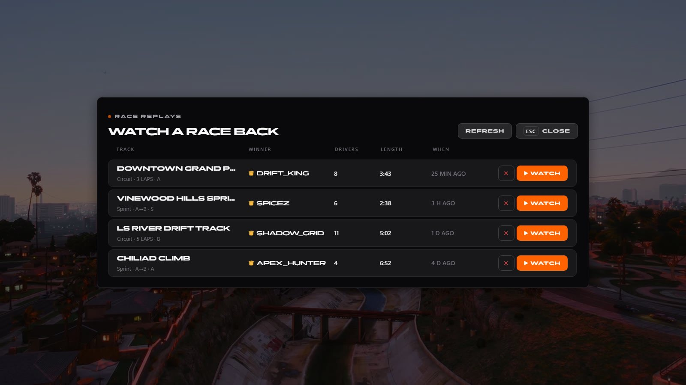

# Race replays

> Server-side race replays with broadcast cameras.

> Part of [spz-races](spz-races.md): this was the separate resource `spz-replay` until it was merged in. Nothing to install on its own.

## Overview

Every race is recorded server-side, compressed into the database and can be played back with TV, chase, heli, bonnet, wheel and free cameras, driver switching and a clean record view.



## Features

- Automatic recording of every race
- Compressed storage
- Multiple camera modes and driver switching

## Configuration

- `spz-races/config_replay.lua` (`Config.Replay`)

See the file for every option.

## Exports

| Export | Side |
|---|---|
| `WatchRace` | client |

```lua
exports["spz-races"]:WatchRace(...)
```

---

Source: [https://github.com/SPiceZ21/spz-races](https://github.com/SPiceZ21/spz-races)
