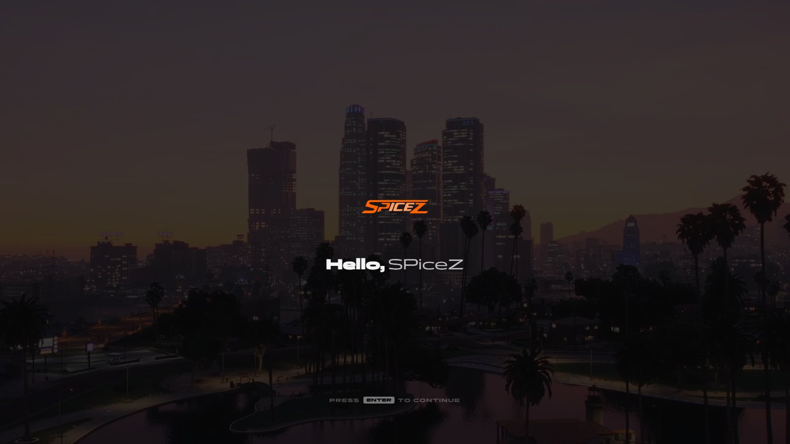
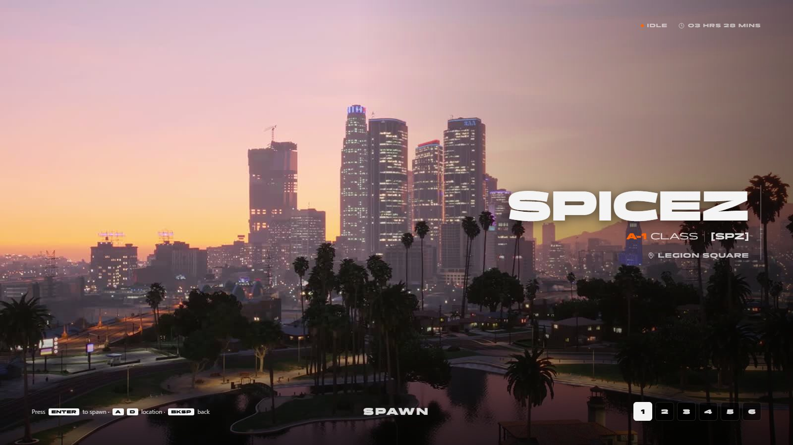

# Spawning

> Spawn flow: character creation, play menu and cinematic world entry.

> Part of [spz-core](spz-core.md): this was the separate resource `spz-spawn` until it was merged in. Nothing to install on its own.

## Overview

Takes the player from the loading screen to the world: new players go through character creation (fivem-appearance), everyone lands on the play menu, and the entry is covered by a transition so the world never pops in.

## Features

- First-join character creation
- Two-screen entry: a welcome ("Hello, name", Enter to continue), then a showcase with your name, class, crew and location slots, with a transition between them
- Play menu with cinematic camera
- Loading-screen progress stages (with spz-loading)
- Transition cover over every spawn

## Configuration

- `spz-core/config_spawn.lua (`Config.Spawn`; anything not set there falls back to spz-core's `config.lua`)`

See the file for every option.

---

Source: [https://github.com/SPiceZ21/spz-core](https://github.com/SPiceZ21/spz-core)
