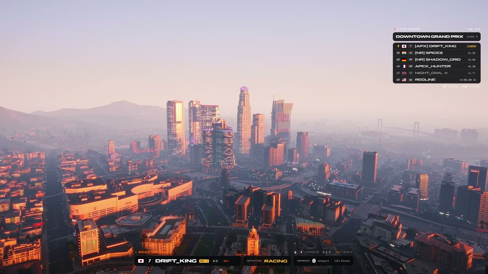

# Spectate and the live race board

> Spectator mode and the live race board.

> Part of [spz-races](spz-races.md): this was the separate resource `spz-spectate` until it was merged in. Nothing to install on its own.

## Overview

Lets any player spectate anyone online — including racers in private buckets — with a clean overlay of their live data, plus a live race board for following a race.



## Features

- Spectate any player, across routing buckets
- Live position, lap, speed and car
- Race board: full / mini / hidden

## Configuration

- `spz-races/config_spectate.lua` (`Config.Spectate`)

See the file for every option.

## Commands

| Command | Who | Description |
|---|---|---|
| `/raceboard` | player | Cycle the race board |
| `/raceboard_hide` | player | Hide / restore the race board |
| `/spectate` | player | Toggle spectator mode |

## Key binds

Rebindable in **Settings → Key Bindings → FiveM**.

| Action | Default |
|---|---|
| Toggle spectator mode | _unbound_ |
| Race board: cycle full / mini / hidden | `F9` |
| Race board: hide or restore | `F11` |

## Exports

| Export | Side |
|---|---|
| `GetBoard` | server |
| `IsSpectating` | client / server |

```lua
exports["spz-races"]:GetBoard(...)
```

---

Source: [https://github.com/SPiceZ21/spz-races](https://github.com/SPiceZ21/spz-races)
