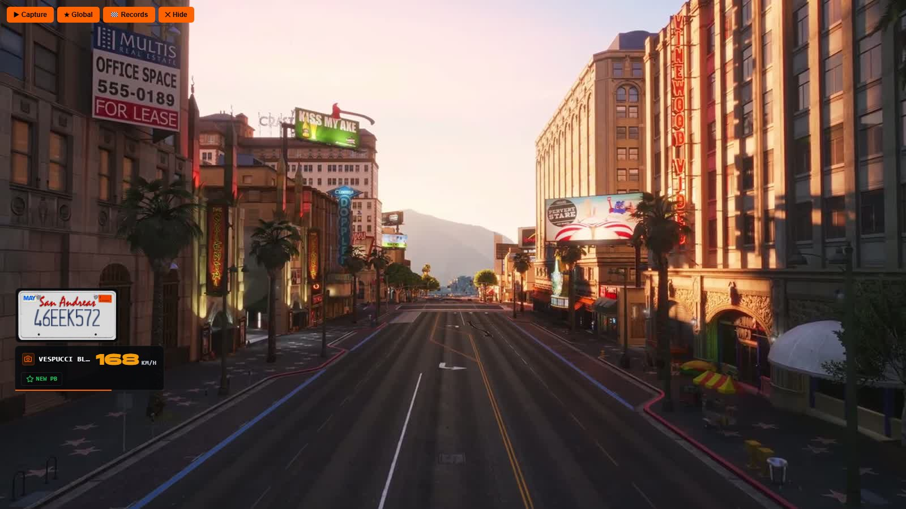

# Speed cameras

> Speed cameras around the map with personal and server records.

> Part of [spz-races](spz-races.md): this was the separate resource `spz-speedcam` until it was merged in. Nothing to install on its own.

## Overview

Fixed speed cameras across the map. Drive through one fast to set your best; the fastest pass per camera is the server record.

## Features

- Camera network with blips
- Personal bests and server records
- Flash and readout on pass

## Configuration

- `spz-races/config_speedcam.lua` (`Config.Speedcam`)

See the file for every option.

## Key binds

Rebindable in **Settings → Key Bindings → FiveM**.

| Action | Default |
|---|---|
| Speed camera records | `F2` |

---

Source: [https://github.com/SPiceZ21/spz-races](https://github.com/SPiceZ21/spz-races)
