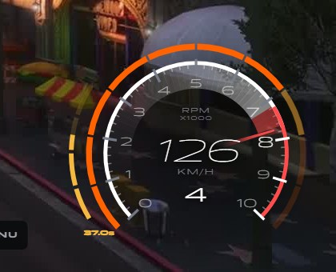
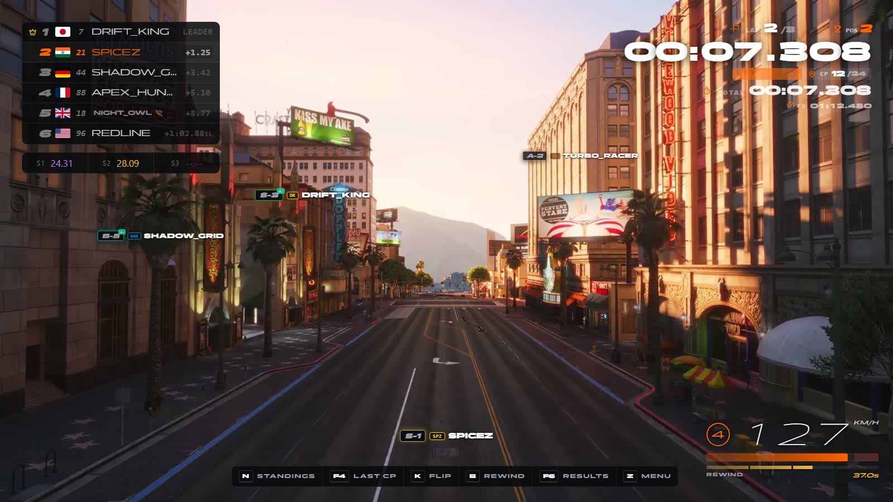

# Speedometer

> Racing speedometer.

> Part of [spz-hud](spz-hud.md): this was the separate resource `spz-speedometer` until it was merged in. Nothing to install on its own.

## Overview

A themed racing speedometer: speed, gear, RPM and rewind / boost meters during races.





## Features

- Speed, gear and RPM
- Rewind credit and boost meters

## Exports

| Export | Side |
|---|---|
| `SpeedometerDemo` | client |
| `SetSpeedometerHidden` | client |
| `SetRewindCredit` | client |
| `SetSideBoost` | client |

```lua
exports["spz-hud"]:SetRewindCredit(usedMs, maxMs)
```

---

Source: [https://github.com/SPiceZ21/spz-hud](https://github.com/SPiceZ21/spz-hud)
