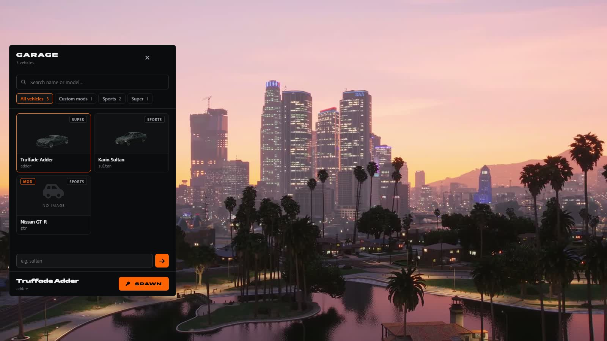
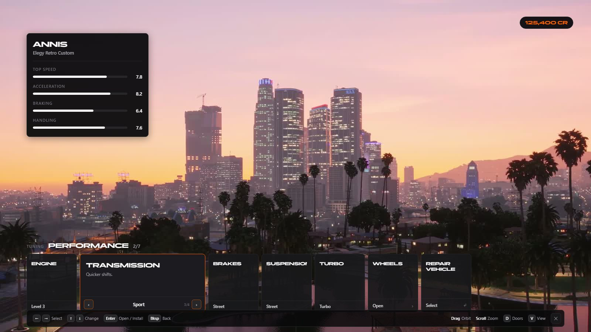

# spz-vehicles

> Everything about cars: registry, classes, race spawns, upgrades, saved customisation, the garage, the tuner and vehicle functions.

 

## Overview

Knows every car the server offers and its class, spawns race and freeroam vehicles server-side, applies performance upgrades and each player's saved customisation. Race cars get a random chameleon paint.

It also runs the garage (`F5`), the tuner and the small driving functions (indicators, hazards, headlight flash, horn taunt, idle camera). They were spz-carspawner, spz-tunners and spz-vehfunc before they were merged in; [spz-hud](spz-hud.md) draws the garage and tuner pages.

## Features

- Car registry and class classification (incl. add-on cars)
- Server-side race spawns
- Saved customisation per player and car
- Vanity plates on every car
- Garage: searchable list of every car, class filter, add-ons included, `/car <model>`
- Tuner: performance and body parts, paint (incl. chameleon), wheels, neon, liveries; in freeroam, race warmup (`Y`) and Hot Pursuit's car setup
- Indicators, hazards, headlight flash, horn taunt, idle camera

## Requirements

| Resource | Type |
|---|---|
| `ox_lib` | third-party |
| `spz-core` | SPiceZ module |
| `spz-hud` | SPiceZ module (draws the garage and tuner) |
| `oxmysql` | third-party |

## Installation

Included in the [txAdmin recipe](https://github.com/SPiceZ21/spz-txrecipe). Manual install:

1. Download `spz-vehicles` from GitHub (latest release, or the repository) into your `resources` folder.
2. Add to `server.cfg`, after its requirements:

```cfg
ensure spz-vehicles
```

## Configuration

- `config.lua`
- `config_tuner.lua` (`Config.Tuner`: menu position, command, shops, pricing, auto apply)

See the file for every option.

## Commands

| Command | Who | Description |
|---|---|---|
| `/car` | player | Open the garage, or `/car <model>` |
| `/dv` | player | Delete your vehicle |
| `/tune` | player | Open the tuner |
| `/customs` | player | Open customs |
| `/save_customs` | player | Save the current setup |
| `/idlecam` | player | Toggle the idle camera |
| `/resetcustom` | player | Reset it |
| `/savecustom` | player | Save the current car's customisation |
| `/reclassify` | admin | Recompute car classes |
| `/spzaddons` | admin | List add-on cars |
| `/spzaddonscan` | admin | Scan for add-on cars |
| `/vehcheck` | admin | Inspect the car you are in |

## Key binds

Rebindable in **Settings → Key Bindings → FiveM**.

| Action | Default |
|---|---|
| Open Car Spawner | `F5` |
| Left / right indicator | `LEFT` / `RIGHT` |
| Hazard lights | `J` |
| Flash headlights | `L` |
| Horn taunt (beep + flash) | `G` |





## Exports

| Export | Side |
|---|---|
| `ApplyVehicleMods` | client |
| `DespawnVehicle` | server |
| `GetAddonRaceClasses` | server |
| `GetAllPollOptions` | server |
| `GetClassification` | server |
| `GetClassMeta` | server / shared |
| `GetPlayerVehicle` | server |
| `GetPollPool` | server |
| `GetRaceClasses` | server |
| `GetVehicleData` | server |
| `GetVehicleMods` | client |
| `GetVehicleRegistry` | server |
| `IsRegistered` | server |
| `LoadCustomization` | server |
| `OpenTunerMenu` | client |
| `SpawnRaceVehicle` | server |
| `SpawnVehicle` | server |
| `UnlockRaceVehicle` | server |

```lua
exports["spz-vehicles"]:DespawnVehicle(...)
```

---

Source: [https://github.com/SPiceZ21/spz-vehicles](https://github.com/SPiceZ21/spz-vehicles)
